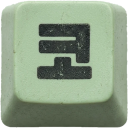

<p align="center">
  
</p>

<h1 align="center">Koding</h1>

<p align="center"><b>A Korean study desk for Obsidian, built around one activity:<br>making a short voice note for someone who will hear it.</b></p>

---

## What this is

Koding is an **Obsidian overlay for a standalone mini-app**. The study tool itself is small and self-contained: a Desk with one button, a recorder, a shadow player, a quiz and an archive. This plugin runs it inside Obsidian, so everything it makes lives as ordinary notes and audio files in your vault.

Koding expects a set of folders and files to exist (see the layout under [First run](#first-run)). If any are missing, the **Set up** button in *Settings → Koding* creates them. It only adds what's missing and never overwrites or moves what's already there, so it's safe to press any time. Koding also checks for these folders again whenever you close its settings.

Most language apps are built around review queues. Koding is built around *output*. Each session makes, or continues, one voice note: 20 to 60 seconds of Korean for a real person (a friend, a partner, a language-exchange partner). Writing, correcting, listening, shadowing, recording and review all happen inside that note or beside it.

It is designed for people who study in bursts, have bad days, and drop off apps that punish gaps. It never shows streaks, due counts or backlogs, and after a gap of any length the Desk looks exactly as it did the day before.

> Desktop only. Koding runs local programs (edge-tts, ffmpeg, Whisper) and uses Electron's browser view for the AI tabs.

## A session

| Step | What happens |
|---|---|
| **Seed** | Start from a phrase you caught, a line from a film or story, or something you want to say. |
| **Draft** | Write it in Korean yourself, however rough. Put English in brackets where you're stuck, or write it all in English and have it translated. |
| **Correct** | Your recipient corrects it, an AI corrects it, or both. |
| **Model** | Koding generates a native-voice model of the corrected text at normal and slow speed. |
| **Shadow** | Read it aloud, then shadow the model sentence by sentence. |
| **Takes** | Record it as many times as you like, straight from the note. |
| **Done** | Mark it done and send it however you like. |

Steps can be spread over days. An unfinished note simply becomes the next button on the Desk. A session that is only "record three more takes" is a full session.

## Features

- **Desk.** Opens at startup with one large button: the next action. Koding works it out from your files, so you never pick from a menu.
- **Just listen.** A low-energy mode that plays your finished notes and their models. Nothing to recall, nothing to score.
- **AI bookmarks.** Claude, ChatGPT, Gemini, NotebookLM or any URL, opened in an Obsidian tab beside your note with logins that persist. *Send to AI* copies a ready-made prompt packet; *Take reply* pastes the answer back into the note.
- **Tutor roles.** Editable Markdown prompts in `Tutor/`: Corrector, Noticer ("let me try first"), Seed finder, Listener, Look back, Translator, Explainer, Questions and Quiz. A shared `_Rules.md` keeps every AI reply free of streaks, homework, romanization and scoring.
- **Model voice.** Free neural text-to-speech through [edge-tts](https://github.com/rany2/edge-tts), with sentence timings. Any other TTS engine can be plugged in with a command template.
- **Shadow player.** Plays a sentence, pauses for you to repeat it, moves on. Loop a sentence or switch between normal and slow speed.
- **Recorder.** Records takes into the note and converts them with ffmpeg (m4a, mp3, ogg or wav).
- **Listener.** Runs your local [Whisper](https://github.com/openai/whisper) on your latest take and marks where what it heard differs from your text.
- **Words and quizzes.** Tick the words you know, ask about the ones you don't, and get a short cloze quiz in [Spaced Repetition](https://github.com/st3v3nmw/obsidian-spaced-repetition) flashcard format. Take it inside Koding, one card at a time.
- **Today's handful.** A few words from your own notes, shown in the sentences you used them in.
- **Archive and Look back.** Every finished note with its last take, so your first note can be played next to your thirtieth.
- **Phone inbox.** Anything that lands in `Inbox/` (via a synced folder such as Google Drive, Dropbox or Syncthing) is picked up: text becomes a seed, audio can be attached as a take, kept as a seed, or filed.

Everything is stored as plain Markdown and audio files. Switch the plugin off and your vault is still a readable folder of notes.

## Requirements

| Program | Used for | Install |
|---|---|---|
| [Obsidian](https://obsidian.md) 1.5+ (desktop) | everything | |
| [edge-tts](https://github.com/rany2/edge-tts) | model voice | `pip install edge-tts` |
| [ffmpeg](https://ffmpeg.org) | converting takes | optional if you keep takes as `.webm` |
| [Whisper](https://github.com/openai/whisper) or [whisper-ctranslate2](https://github.com/Softcatala/whisper-ctranslate2) | Listener | `pip install openai-whisper` |

Each program has a **Test** button in the settings. Everything else in Koding works without them.

## Install

Koding is not in the community plugin list yet.

**From a release**
1. Download `main.js`, `manifest.json` and `styles.css` from the latest release.
2. Put them in `<your vault>/.obsidian/plugins/koding/`.
3. In Obsidian, go to *Settings → Community plugins*, reload, and enable **Koding**.

**With BRAT**: add this repository's URL in [BRAT](https://github.com/TfTHacker/obsidian42-brat).

## First run

1. Open *Settings → Koding*.
2. Under **Who and what**, set **Notes are for** to the name of the person you're writing to. It goes into each note's `to:` line and into the AI prompts.
3. Press **Set up** (under *Set up the vault*, at the bottom of the settings). It creates any folders, files and tutor roles from the layout below that aren't there yet, and leaves existing ones alone.
4. Add or reorder your **AI bookmarks**. The first one that opens in a tab receives *Send to AI* requests.
5. Open the Desk from the ribbon (✉) or the command palette and press the big button.

Default vault layout (every path can be changed in the settings):

```
<vault>/
├── Notes/            one file per voice note
├── Audio/
│   ├── Takes/        your recordings
│   ├── Models/       generated model voice
│   └── Phone/        audio kept from the inbox
├── Inbox/            phone uploads land here (processed files move to Inbox/_done/)
├── Tutor/            AI role prompts, one Markdown file each, plus _Rules.md
├── Quizzes/          one file per quiz, Spaced Repetition format
├── Sources/          texts and subtitle files the Seed finder draws from
│   └── Archive/      older texts that join the Archive and Just listen
├── Seeds.md          seeds, newest first
├── Words.md          the word pool for Today's handful
└── Log.md            dated one-liners
```

## A note

```markdown
---
to: Minji
date: 2026-11-14
seed: "귤 따러 갈래? (2026-11-13)"
status: draft            # draft → corrected → recorded → done
---

## Draft
귤 [pick] 갈래?

## Corrections
### Minji
### AI

## Final
귤 따러 갈래?

## Model
## Takes
## Heard
## Questions
## Answers
## Checklist
## Quiz
## Words
```

The draft is never overwritten, so draft and final side by side show what you could already say and what had to be corrected.

## Commands

All commands start with **Koding:** in the command palette.

| Command | |
|---|---|
| Open the Desk / Do the next action | the one-button flow |
| Start a new note / Open the note in progress | |
| Record a take (start / stop) | |
| Make the model voice / Open the shadow player | |
| Listener: what did Whisper hear in the latest take? | |
| Send to AI (choose a role), plus shortcuts for each role | copies a prompt packet and brings the AI tab forward |
| Take reply | pastes the AI's answer from the clipboard into the note |
| Look back / Open the Archive / Just listen | |
| Quiz: a few cards / Quiz: every card in this file | |
| Mark this note done / Check the Inbox now / Add a line to the log | |

Selecting text in a note also adds *Translate*, *Correct*, *Explain*, *Ask about this* and *Use as Final* to the right-click menu.

## Other languages

Koding was built for Korean, but the language name, Whisper language code, TTS voice and tutor prompts are all settings or editable files. Turn off **Hangul lines only from source texts** and edit the `반말` lines in `Tutor/` to use it for another language.

## Development

```bash
npm install
npm run dev      # watch build
npm run build    # type-check and production build
npm test         # text helper tests
```

To have each build copied into a test vault, put the vault's path in a file named `.vault` in the project root (it is git-ignored), or set the `KODING_VAULT` environment variable.

## License

[MIT](LICENSE)
